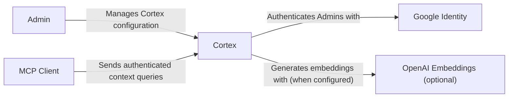
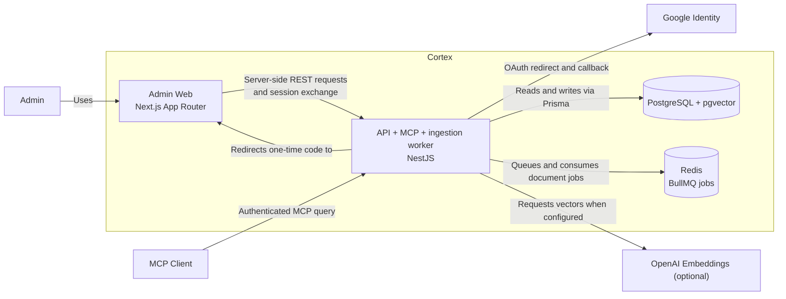
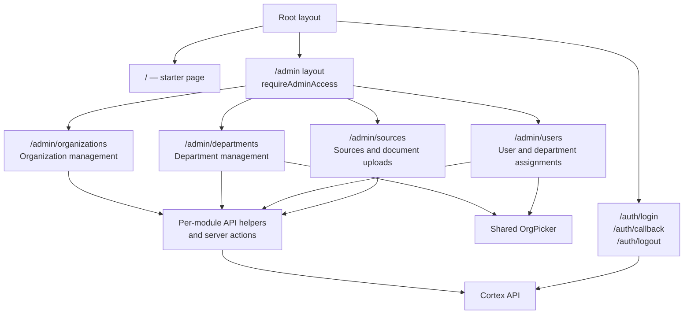
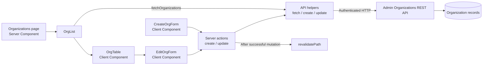

# Cortex Architecture

These diagrams describe the implemented system, not planned product scope. They use editable Mermaid diagrams and a C4-inspired progression from system context to runtime containers and Admin Web modules. Update them when the represented boundaries or flows change.

The context/container and frontend-module views are inspired by [Visualizing Frontend Architecture](https://frontendatscale.com/issues/17/) and the [C4 Model](https://c4model.com/).

The `apps/docs` project is currently a starter template and is not shown as a Cortex runtime container. The MCP query endpoint is implemented, but its policy and context responses are currently stubs.

## Level 1: System context

An Admin uses the Admin Web to configure Cortex. An MCP Client sends authenticated queries to Cortex. Google provides Admin identity, and OpenAI is contacted only when the API is configured to use its embedding provider.

## Level 2: Runtime containers

The Admin Web is a server-rendered Next.js application. The NestJS API serves the Admin REST and MCP endpoints, and currently hosts the BullMQ ingestion worker in the same process. PostgreSQL stores application data and vectors; Redis carries ingestion jobs.

### Authentication and request flow

1. The Admin Web sends the browser to the API's Google OAuth route.
2. After Google returns a verified identity, the API resolves the User and issues a short-lived, single-use code.
3. The API redirects the browser to the Admin Web callback with that code; the web server exchanges it with the API and stores the returned session token in an HTTP-only cookie.
4. Admin pages verify the session and role through `GET /api/me`. Server-rendered pages and server actions call the API with the token from that cookie.

### Document ingestion flow

The Sources module uploads a Document through the API. The API persists it as pending and enqueues a BullMQ job in Redis. The API's worker processes the job, chunks the Document, requests embeddings from the configured provider, and persists the results in PostgreSQL.

## Level 3: Admin Web modules

The route map reflects the current App Router. The root page is still a starter page; the implemented Admin modules are organizations, departments, users, and sources. All `/admin/*` routes pass through the Admin access gate.

| Route                                           | Responsibilities                                                               | Implementation map                                                          |
| ----------------------------------------------- | ------------------------------------------------------------------------------ | --------------------------------------------------------------------------- |
| `/`                                             | Starter landing page                                                           | [`apps/web/app/page.tsx`](../apps/web/app/page.tsx)                         |
| `/auth/login`, `/auth/callback`, `/auth/logout` | Start Google sign-in, exchange the one-time code, and clear the session cookie | [`apps/web/app/auth/`](../apps/web/app/auth/)                               |
| `/admin/organizations`                          | View, create, and edit organizations                                           | [`apps/web/app/admin/organizations/`](../apps/web/app/admin/organizations/) |
| `/admin/departments`                            | Select an Organization, then manage its Departments                            | [`apps/web/app/admin/departments/`](../apps/web/app/admin/departments/)     |
| `/admin/users`                                  | Select an Organization, view its Users, and assign Departments                 | [`apps/web/app/admin/users/`](../apps/web/app/admin/users/)                 |
| `/admin/sources`                                | Manage Sources and upload Documents                                            | [`apps/web/app/admin/sources/`](../apps/web/app/admin/sources/)             |

The root layout lives at [`apps/web/app/layout.tsx`](../apps/web/app/layout.tsx). The shared Admin gate is [`apps/web/app/admin/layout.tsx`](../apps/web/app/admin/layout.tsx), backed by [`admin-auth.ts`](../apps/web/app/admin/_lib/admin-auth.ts). The Department and User pages share [`OrgPicker`](../apps/web/app/admin/_components/OrgPicker.tsx).

## Level 4: UI breakdown — Organizations

The Organizations page demonstrates the frontend's current server-first pattern: the page fetches the list on the server, while forms submit through server actions. The API remains the authority for authorization and persistence.

Relevant implementation: [`page.tsx`](../apps/web/app/admin/organizations/page.tsx), [`OrgTable.tsx`](../apps/web/app/admin/organizations/OrgTable.tsx), [`OrgForm.tsx`](../apps/web/app/admin/organizations/OrgForm.tsx), [`actions.ts`](../apps/web/app/admin/organizations/actions.ts), and [`api.ts`](../apps/web/app/admin/organizations/api.ts).

## Keeping these diagrams accurate

- Check the source files linked above when a route, container, integration, or request flow changes.
- Keep the root [GLOSSARY.md](../GLOSSARY.md) as the authority for domain terms.
- Record consequential architectural choices in [Architecture Decision Records](adr/); diagrams describe structure and do not replace decision rationale.
